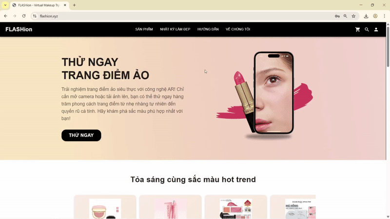

# Flashion - Beauty E-commerce Platform

Flashion is an online shop for beauty products with a virtual makeup try-on feature. It was built as a team project for a startup course in 2025. The backend uses FastAPI and MongoDB, the frontend uses React and TypeScript, and both can run in Docker. The user interface is in Vietnamese.

## Project status

This is a course project, not a finished commercial product.

- The main shopping, admin and virtual makeup features work, as shown in the demo below.
- Most testing was done by hand. A small backend test suite (pytest) covers the order total calculation and checks that the old free membership upgrade endpoint is gone. There are no frontend tests.
- Payment is a manual bank transfer that an admin confirms. There is no payment gateway.
- Some parts are simplified. For example, password reset requests are kept in server memory and handled by an admin.

## Team & my role

Flashion was a team project for a startup course (2025).

My role (Mai Anh Quan, [@Qcymaq](https://github.com/Qcymaq)):

- Main developer of the application.
- Market research and user surveys.

## Features

### For customers
- **Accounts** - Register and log in with email or phone number, edit profile, change password. Password reset requests are handled by an admin.
- **Product catalog** - Browse by category, search, and view product details (summary and full description).
- **Cart and checkout** - Add products to the cart, check out with a shipping address and phone number, pay by bank transfer.
- **Orders** - View order history and status (pending, processing, shipped, delivered, cancelled). Pending orders can be cancelled.
- **Virtual makeup** - Upload a photo and try lip and cheek colors. Face landmarks come from MediaPipe Face Mesh; colors are applied with OpenCV.
- **Memberships** - Free, Gold and Diamond tiers with different virtual try-on limits. Users send an upgrade request with a payment proof; an admin reviews it and changes the tier.
- **Beauty tips** - Articles by category, with comments and likes.
- **Product reviews** - Write and read reviews (login required).
- **Consultations** - Book a beauty consultation.

### For admins
- **Dashboard** - Sales, order and user statistics; sales reports with CSV export.
- **Management pages** - Products (with image upload), orders, users, beauty tips and consultations.
- **Requests** - Membership upgrade requests and password reset requests.

## Demo

### 1. Frontend tour (public pages)
*A walkthrough of the public pages without logging in.*


**What you will see:**
- Homepage and navigation
- Product browsing and search
- Beauty tips and tutorials
- Virtual makeup page
- Public product catalog
- Layout on different screen sizes

### 2. Features demo (logged-in user and admin)
*Core features and user interactions.*



**Features shown:**
- Login
- Shopping cart and checkout
- Product reviews and ratings
- Admin panel
- Order management
- Creating beauty tips
- User profile

## Tech stack

**Backend:** Python 3.11, FastAPI, MongoDB (Motor and Beanie), Pydantic v2, JWT login (python-jose, passlib with bcrypt), MediaPipe and OpenCV for virtual makeup, pandas for CSV reports.

**Frontend:** React 18, TypeScript, Material UI, React Router, React Context for state, Framer Motion.

**Infrastructure:** Docker and Docker Compose, Nginx (serves the frontend build), MongoDB Atlas.

## Getting started with Docker

Requirements: Docker with Docker Compose, and a MongoDB database (for example MongoDB Atlas).

```bash
# 1. Clone the repository
git clone https://github.com/Qcymaq/Flashion.git
cd Flashion

# 2. Create your configuration
cp .env.example .env
# Edit .env: set MONGO_URI and JWT_SECRET (see "Configuration" below).
# Generate a JWT secret with:
python -c "import secrets; print(secrets.token_urlsafe(64))"

# 3. Build and start
docker-compose build
docker-compose up -d
docker-compose logs -f
```

With the default `ENV=production`, the backend refuses to start until `JWT_SECRET` is set to a real value.

After start-up:

- Backend API: http://localhost:8000/api
- Interactive API documentation (Swagger UI): http://localhost:8000/api/docs
- Health check: http://localhost:8000/health

Notes:

- The frontend container does not publish a port. In the original deployment, an Nginx server on the host forwarded traffic to it. For local work, run the frontend with npm (see below).
- The frontend build uses `REACT_APP_API_URL` from `docker-compose.yml` (currently `https://flashion.xyz/api`). Change it to your own domain before building.

## Local development without Docker

Requirements: Python 3.11, Node.js 18 or newer, and a MongoDB database (local or Atlas).

**Backend**

```bash
cd backend
python3.11 -m venv .venv
source .venv/bin/activate
pip install -r requirements.txt
cp .env.example .env      # ENV=development; set MONGO_URI if not using local MongoDB
uvicorn app.main:app --reload --host 0.0.0.0 --port 8000
```

Run the backend from the `backend` folder, because the app uses relative paths for uploads and static files.

**Frontend**

```bash
cd frontend
npm install
cp .env.example .env.local   # set REACT_APP_API_URL=http://localhost:8000/api
npm start                    # http://localhost:3000
```

**Tests**

```bash
cd backend
pip install -r requirements-dev.txt
pytest
```

The tests use small in-memory fakes instead of MongoDB, so no database is needed.

## Configuration

Copy `.env.example` to `.env` (repository root, used by Docker Compose) or `backend/.env.example` to `backend/.env` (local backend). Never commit real values.

### Backend variables

| Variable | Required | Description |
| --- | --- | --- |
| `ENV` | No | `production` or `development`. Default: `development` (Docker Compose defaults to `production`). In production the backend refuses to start without a real `JWT_SECRET`, and uvicorn runs without auto-reload. In development uvicorn auto-reloads and logs at debug level. |
| `MONGO_URI` | Yes | MongoDB connection string. Default outside Docker: `mongodb://localhost:27017`. |
| `JWT_SECRET` | Yes in production | Secret used to sign login tokens. `SECRET_KEY` is accepted as a fallback name. In development, if it is missing, a random secret is generated at each start (all logins become invalid after a restart). |
| `ADMIN_EMAIL`, `ADMIN_PASSWORD` | No | If both are set, `backend/startup.sh` creates this admin account when it does not exist yet. Admin creation is skipped when they are empty or the password is still the `change-me` placeholder. The password is never written to the logs. |
| `ACCESS_TOKEN_EXPIRE_MINUTES` | No | Login token lifetime in minutes. Default: 43200 (30 days). |
| `ALLOWED_ORIGINS` | No | Comma-separated list of allowed CORS origins. Default: `http://localhost:3000`. |

`docker-compose.yml` passes `ENV`, `MONGO_URI`, `JWT_SECRET`, `ADMIN_EMAIL` and `ADMIN_PASSWORD` to the backend container. To use `ACCESS_TOKEN_EXPIRE_MINUTES` or `ALLOWED_ORIGINS` with Docker, add them to the `environment` list there. The other entries in `.env.example` (`DATABASE_NAME`, `ALGORITHM`, `HOST`, `PORT`, `DEBUG`) are not read by the code at the moment.

### Frontend variables

These are read when the frontend is built: from `frontend/.env.local` for `npm start` / `npm run build`, or from the root `.env` as build arguments in Docker Compose.

| Variable | Description |
| --- | --- |
| `REACT_APP_API_URL` | Base URL of the backend API, for example `http://localhost:8000/api`. |
| `REACT_APP_BANK_NAME` | Bank name for bank transfer payments (optional). |
| `REACT_APP_BANK_ACCOUNT_NUMBER` | Bank account number (optional). If empty, the shop says that payment details are provided after ordering and asks the customer to contact the shop. |
| `REACT_APP_BANK_ACCOUNT_HOLDER` | Account holder name (optional). |
| `REACT_APP_BANK_QR_URL` | URL of a payment QR code image (optional). The QR code is hidden when empty. |

`REACT_APP_` values are built into the public JavaScript files, so every visitor can see them. Do not put secrets there.

## Project structure

```
Flashion/
├── backend/
│   ├── app/
│   │   ├── models/           # Database models (User, Product, Order, ...)
│   │   ├── routes/           # API endpoints
│   │   ├── schemas/          # Pydantic schemas for validation
│   │   ├── utils/            # Authentication, database, virtual makeup
│   │   ├── static/           # Uploaded files and static assets
│   │   ├── create_admin.py   # Creates the admin user from ADMIN_EMAIL / ADMIN_PASSWORD
│   │   ├── Dockerfile        # Backend image (build context: repository root)
│   │   └── main.py           # FastAPI application entry point
│   ├── tests/                # pytest tests (no database needed)
│   ├── startup.sh            # Container entrypoint: wait for DB, create admin, start API
│   ├── requirements.txt      # Python dependencies
│   └── requirements-dev.txt  # requirements.txt + pytest
├── frontend/
│   ├── src/
│   │   ├── components/       # Reusable React components
│   │   ├── config/           # API endpoints and payment settings
│   │   ├── contexts/         # React contexts (auth, cart)
│   │   ├── pages/            # Page components
│   │   ├── services/         # API service functions
│   │   └── types/            # TypeScript types
│   ├── public/               # Static assets and index.html
│   ├── Dockerfile            # Frontend image (build + Nginx)
│   ├── nginx.conf            # Nginx configuration
│   └── .env.example          # Frontend variables
├── docs/media/               # Demo GIFs
├── docker-compose.yml
└── .env.example
```

## Security

- Login with JWT tokens; passwords are hashed with bcrypt.
- Secrets (JWT secret, admin password, database URI) come from environment variables. In production the backend does not start without a real JWT secret.
- Order item prices and totals are calculated on the server from the product data. New orders always start as `pending`.
- Membership tier changes are made by an admin.
- Input is validated with Pydantic schemas.

## Main API endpoints

All endpoints are listed in the interactive documentation at `/api/docs`.

**Authentication**
- `POST /api/auth/register` - Register
- `POST /api/auth/login` - Log in (returns a JWT)
- `GET /api/auth/me` - Current user
- `POST /api/auth/forgot-password` - Request a password reset
- `POST /api/auth/change-password` - Change password (logged in)
- `POST /api/auth/membership/upgrade-request` - Request a membership upgrade (reviewed by an admin)

**Products**
- `GET /api/products/` - List products (pagination, category filter)
- `GET /api/products/search` - Search products
- `GET /api/products/{id}` - Product details
- `POST /api/admin/products/` - Create a product (admin)
- `PUT /api/admin/products/{id}/` - Update a product (admin)
- `DELETE /api/admin/products/{id}/` - Delete a product (admin)

**Cart and orders**
- `GET /api/cart/`, `POST /api/cart/items/` - Read the cart, add an item
- `POST /api/orders/` - Create an order (the server calculates prices and total)
- `GET /api/orders/` - List my orders (admins see all orders)
- `PUT /api/orders/{id}/cancel` - Cancel a pending order
- `PUT /api/orders/{id}/status` - Update order status (admin)
- `GET /api/admin/orders/` - All orders with user details (admin)

**Beauty tips**
- `GET /api/beauty-tips/` - List beauty tips
- `GET /api/beauty-tips/{id}` - Beauty tip details
- `GET /api/beauty-tips/categories/list` - Categories
- `POST /api/beauty-tips/` - Create a beauty tip (admin)

**Virtual makeup**
- `POST /api/virtual-makeup/try-makeup` - Apply makeup to an uploaded photo (logged in; limited by membership tier)

**Admin**
- `GET /api/admin/stats/` - Dashboard statistics
- `GET /api/admin/users/` - User management
- `PATCH /api/admin/users/{id}/membership/` - Change a user's membership tier
- `GET /api/admin/memberships/` - Membership upgrade requests
- `GET /api/admin/password-reset-requests/` - Password reset requests
- `PUT /api/admin/password-reset-requests/{id}/complete/` - Mark a request as done

**Health**
- `GET /health` - Returns `{"status": "ok"}` (used by the Docker health check)

## Useful Docker commands

```bash
docker-compose build --no-cache          # Rebuild all images
docker-compose up -d                     # Start
docker-compose down                      # Stop
docker-compose logs -f backend           # Follow backend logs
docker-compose ps                        # Service status
docker-compose exec backend bash         # Shell in the backend container
docker-compose restart backend           # Restart the backend
```

## Troubleshooting

- **Backend exits with "JWT_SECRET is not set"** - Set `JWT_SECRET` in `.env` to a long random value, or set `ENV=development` for local testing.
- **Database connection fails** - Check `MONGO_URI`, the network access list in MongoDB Atlas, and `docker-compose logs backend`.
- **No admin account** - Set `ADMIN_EMAIL` and `ADMIN_PASSWORD` in `.env` and restart the backend.
- **Checkout shows "contact the shop" instead of bank details** - Set the `REACT_APP_BANK_*` variables and rebuild the frontend.

## License

No license has been chosen yet, so default copyright rules apply. Please contact the owner before reusing the code.

## Contact

Mai Anh Quan - quanmaianh.work@gmail.com - GitHub [@Qcymaq](https://github.com/Qcymaq) - LinkedIn [maq159](https://www.linkedin.com/in/maq159)
